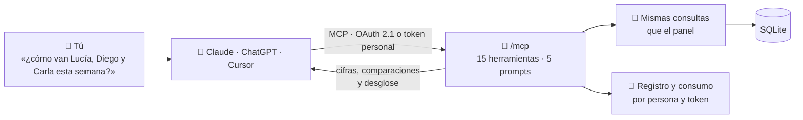
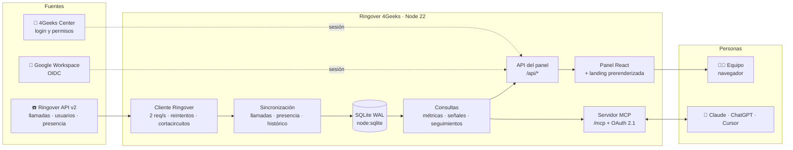
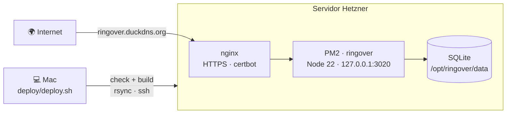

<div align="center">

<picture>
  <source media="(prefers-color-scheme: dark)" srcset="src/web/public/brand/ringover-4geeks-blanco.png">
  
</picture>

# 📞 Ringover 4Geeks · Llamadas + IA

### Cada llamada cuenta. **Ahora, también se entiende.**

*Analítica de llamadas de Ringover por comercial, la jornada en tiempo real, alertas automáticas y un servidor **MCP** para preguntárselo todo a Claude, ChatGPT o Cursor en lenguaje natural.*

<br/>


**Solo lectura · Una sola base de datos · Mismas cifras en el panel, la API y la IA**

### 🟢 EN PRODUCCIÓN → **https://ringover.duckdns.org**

<br/>


</div>

---

## Índice

1. [Por qué existe](#-por-qué-existe)
2. [Qué hace](#-qué-hace)
3. [Las 9 métricas](#-las-9-métricas)
4. [La IA: servidor MCP](#-la-ia-servidor-mcp)
5. [Selección de comerciales](#-selección-de-comerciales)
6. [Arquitectura](#️-arquitectura)
7. [Sincronización con Ringover](#-sincronización-con-ringover)
8. [Acceso, seguridad y privacidad](#-acceso-seguridad-y-privacidad)
9. [Landing pública, SEO y AIO](#-landing-pública-seo-y-aio)
10. [Arranque en local](#-arranque-en-local)
11. [Configuración](#️-configuración)
12. [Despliegue](#-despliegue)
13. [Tests](#-tests)
14. [API HTTP](#️-api-http)
15. [Estructura del proyecto](#️-estructura-del-proyecto)

---

## 💥 Por qué existe

Ringover registra cada llamada, pero no responde a lo que un jefe de equipo se pregunta cada mañana:

- ¿**Cuánto ha llamado** hoy cada comercial, y cuánto **ha hablado** de verdad?
- ¿Cuántas llamadas fueron a **leads nuevos** y cuántas a **seguimientos**?
- ¿Quién lleva **45 minutos conectado sin llamar**? ¿Quién está **por debajo de su propia media**?
- ¿Qué **leads calientes** tuvieron una buena primera conversación y **nadie ha vuelto a llamar**?
- ¿A qué **hora contesta** más la gente?

**Ringover 4Geeks** lo responde de un vistazo en el panel, y en una frase a la IA. Todo es de **solo lectura**: no toca nada en Ringover.

> ### 🔥 Lo que ve un jefe de equipo
> *«Hoy, hasta las 12:40, el equipo lleva **142 llamadas** (98 nuevas) y **5 h 54 min** de conversación. **10** pasaron de 15 minutos; 6 de ellas fueron primeras conversaciones.»*
>
> Y debajo: Diego lleva 45 min conectado sin llamar 🟠 · Carla, un 40 % por debajo de su media de los jueves 🔴 · **47 leads calientes** sin seguimiento.
>
> *Las cifras de este ejemplo son de la demo.*

---

## ✨ Qué hace

| | Función | Qué te da |
|---|---|---|
| 📊 | **Resumen** | Las 9 métricas del día o de cualquier rango, comparadas con el mismo tramo anterior (hoy, **hasta la misma hora**), tabla por comercial, evolución, ritmo por hora y duración de las conversaciones |
| 🕒 | **Jornada** | La línea de tiempo del día de cada comercial: cuándo estuvo conectado, en «no molestar» y cada llamada en su hora real |
| 🔎 | **Llamadas** | Listado con filtros (nuevas, contestadas, duración, teléfono) y el historial completo de cada número |
| 👥 | **Selección de comerciales** | Elige a varios y **todo** el panel pasa a ser solo de ellos. Viaja en la URL y se recuerda |
| 🚨 | **Señales** | Cada comercial comparado con **su propia media**: menos llamadas de lo habitual, poco tiempo hablando, conectado sin llamar, buenas primeras conversaciones |
| 🧠 | **IA por MCP** | 15 herramientas y 5 informes listos para Claude, ChatGPT y Cursor, con conector OAuth, tokens personales, registro y consumo |
| 👤 | **Usuarios** | Acceso con Google Workspace o 4Geeks Center y una lista que gestionan los admins |
| 🌐 | **Landing** | Página de producto prerenderizada, con SEO/AIO, formulario de acceso y textos legales |
| 🌓 | **Diseño** | Tema claro y oscuro, responsive de 320 px a escritorio y gráficos propios con paleta validada para daltonismo |

---

## 📊 Las 9 métricas

Las definiciones viven en **un solo sitio**, [`src/shared/metrics.ts`](src/shared/metrics.ts), y las usan igual el panel, la API y el MCP. Los días se cuentan en **hora de Madrid**.

| Grupo | Métrica | Cómo se calcula |
|---|---|---|
| Volumen | **Llamadas** | Todas las del comercial: salientes y entrantes, contestadas o no |
| | **Nuevas** | A un número con el que **el equipo** aún no había hablado: incluye los intentos sin respuesta y la primera conversación |
| | **Antiguas** | A números con los que ya se había hablado (seguimientos) |
| Tiempo | **Tiempo en llamada** | Conversación real (`incall_duration`) de las contestadas |
| | **Tiempo al teléfono** | Duración total: tono, espera y conversación (`total_duration`) |
| | **Tiempo conectado** | Tiempo con Ringover abierto. La API no lo guarda: la app lo mide cada minuto |
| Calidad | **+15 min** | Contestadas con 15 minutos o más de conversación |
| | **−5 min** | Contestadas con menos de 5 minutos (las no contestadas no cuentan) |
| | **Nuevas +15 min** | Primeras conversaciones de 15 minutos o más |

**Reglas que se cumplen siempre**

- Una llamada es «contestada» solo si hubo conversación (más de 0 s).
- Los números se casan por sus **últimos 9 dígitos**, y las llamadas internas (extensiones) no cuentan.
- **Comparaciones justas:** un día se compara con el mismo día de la semana anterior y, si es hoy, **hasta la misma hora**. Un mes en curso, con el mismo tramo del mes anterior. El resto, con el bloque anterior de la misma longitud.
- Filtrar por comerciales **no cambia** qué llamadas son nuevas: eso siempre se decide respecto a todo el equipo.

---

## 🧠 La IA: servidor MCP

Un servidor **MCP** (Streamable HTTP) en `/mcp` para preguntarle a la IA por las llamadas en lenguaje natural. Es de solo lectura, con los permisos de cada persona y cada consulta registrada.



### Conectarla

| Cliente | Cómo |
|---|---|
| **claude.ai** (web, escritorio y móvil) | Ajustes → Conectores → *Añadir conector personalizado* → URL `https://<tu-dominio>/mcp` → entras con tu cuenta y pulsas **Permitir**. Sin tokens |
| **ChatGPT** | Ajustes → Conectores → Crear, con la misma URL |
| **Claude Code** | `claude mcp add --transport http --scope user ringover https://<tu-dominio>/mcp` y después `/mcp` para iniciar sesión |
| **Cursor y otros** | Token personal desde el panel (IA → Tokens) en la cabecera `Authorization: Bearer …` |

La pantalla **IA** del panel tiene las cuatro pestañas (Conectar, Tokens, Actividad, Consumo) con los pasos, los comandos listos para copiar y el catálogo en vivo de herramientas.

### Herramientas

| Herramienta | Qué hace | 👥 Grupo |
|---|---|:-:|
| `resumen` | Las 9 métricas de un día o rango, con comparación y desglose por comercial | ✓ |
| `evolucion` | Serie por día, semana o mes (hasta 400 días) | ✓ |
| `comparar` | Dos periodos cualesquiera, frente a frente | ✓ |
| `ranking` | Comerciales ordenados por cualquier métrica | ✓ |
| `llamadas` | Listado con filtros: tipo, resultado, duración y teléfono | ✓ |
| `historial_numero` | Todas las llamadas con un teléfono y su primera conversación | |
| `jornada` | El día de un comercial: tramos conectado y huecos de 30 min sin llamar | |
| `estado_ahora` | Quién está conectado, en llamada o en «no molestar» | ✓ |
| `comerciales` | Lista de comerciales | |
| `definiciones` | Cómo se calcula cada métrica y lo frescos que están los datos | |
| `alertas` | Señales del día: cada comercial frente a su propia media | ✓ |
| `seguimientos_pendientes` | Leads con una buena primera conversación que nadie ha vuelto a llamar | ✓ |
| `mejores_horas` | Tasa de contacto por día de la semana y hora | ✓ |
| `comparar_comerciales` | Varios comerciales lado a lado, con ratios | ✓ |
| `informe` | Informe diario o semanal en Markdown, listo para Slack o un email | ✓ |

**Prompts** (aparecen como comandos en Claude): `/informe_diario`, `/informe_semanal`, `/revisar_comercial`, `/revisar_grupo` y `/seguimientos`.

**Pensado para que la IA no se equivoque**

- **Atajos de fecha** (`hoy`, `ayer`, `esta_semana`, `semana_pasada`, `este_mes`, `mes_pasado`, `ultimos_7_dias`, `ultimos_30_dias`): la IA no calcula fechas a mano. Además, las instrucciones del servidor le dicen qué día es hoy.
- **Cifras crudas y legibles** a la vez (`tiempo_en_llamada_s` y `"5 h 54 min"`) en JSON compacto, que ahorra en torno a un 30 % de contexto.
- **Errores que se corrigen solos:** fechas imposibles, rangos al revés o un comercial que no existe devuelven un mensaje claro que nombra el problema.

### Seguridad del MCP

- **OAuth 2.1** propio para los conectores (RFC 9728, 8414 y 7591): PKCE S256, consentimiento con la sesión del panel y *refresh tokens* que rotan. Si se reutiliza un refresh token, se revoca toda la conexión.
- **Tokens personales** `rgo_p_…`: se guardan como hash SHA-256, se ven una sola vez y caducan a los 30, 90 o 365 días, o nunca.
- **Límites por token:** 60 consultas por minuto y 2.000 al día (configurables).
- **Registro** de cada llamada (herramienta, argumentos, latencia, tamaño y resultado) durante 180 días, con pantallas de Actividad y Consumo.

---

## 👥 Selección de comerciales

Para mirar a **varios comerciales a la vez**, en el panel y en la IA.

- **En el panel:** el botón **«Todo el equipo»**, junto a las fechas, abre un buscador con casillas (sin tildes: «lucia» encuentra a Lucía). Primero salen los activos y aparte los que no llaman. Cifras, comparación, tabla, gráficos y «Ahora mismo» pasan a ser solo de ellos.
- **En la URL:** `?comerciales=101,103` (el `0` son las llamadas sin asignar). Se comparte con un enlace, se mantiene al cambiar de pantalla y el navegador recuerda la última selección.
- **En la IA:** el parámetro `comerciales` admite nombres, emails o ids en las 11 herramientas marcadas con 👥, y el prompt `/revisar_grupo` analiza un grupo de una vez. Si un nombre no existe, el error dice cuál.

---

## 🏗️ Arquitectura

Una sola aplicación de **TypeScript**: un servidor **Hono** sirve la API, el MCP, el OAuth y el panel **React** compilado, sobre una base **SQLite** en un único fichero.



**Decisiones de diseño**

- **Una sola fuente de verdad.** Las definiciones de métricas, días y comparaciones están en `src/shared/` y las usan igual el servidor, el panel y el MCP. La batería de aceptación comprueba que todas las herramientas dan las mismas cifras.
- **SQLite con WAL** (`node:sqlite`, sin dependencias nativas): un fichero, migraciones versionadas y consultas en milisegundos.
- **Un cliente de Ringover resiliente:** cola a 2 peticiones por segundo, timeout, reintentos con espera exponencial y aleatoria, respeto de `Retry-After` y un cortacircuitos que pausa las llamadas a la API si falla varias veces seguidas.
- **«Nueva» se recalcula de forma incremental:** solo para los números que han cambiado, y respetando el histórico anterior importado.
- **Validación en todos los límites** con Zod: variables de entorno, respuestas de Ringover, peticiones de la API y argumentos del MCP.
- **Sin librerías de gráficos ni de rutas:** SVG propios y un router mínimo, para que el panel cargue rápido.

---

## 🔄 Sincronización con Ringover

| Tarea | Frecuencia |
|---|---|
| Llamadas | Cada **3 minutos** de 7 a 22 h (hora de Madrid) y cada 30 minutos fuera de ese horario. También a mano, con el botón ↻ del panel |
| Repaso de los últimos días | Cada noche a las 3 h, porque estados y grabaciones cambian después de la llamada |
| Presencia (conectado, en llamada, «no molestar») | Cada **minuto**. Ringover no guarda el histórico, así que lo mide la app |
| Usuarios | Cada 6 horas |
| Histórico | Al arrancar, hacia atrás en ventanas de 14 días hasta el límite de Ringover (unos 12 meses). Si se corta, retoma donde lo dejó |

Para medir el tiempo conectado, la clave de la API necesita el permiso **Monitoring**. Si falta, el panel lo avisa.

---

## 🔐 Acceso, seguridad y privacidad

| Tema | Cómo |
|---|---|
| **Entrar** | Con **Google Workspace** (OIDC con código, PKCE y nonce; solo el dominio permitido y la lista de acceso) o con la cuenta de **4Geeks Center** (mismos permisos que allí) |
| **Quién entra** | Admins fijos por configuración, más una lista que los admins gestionan en **/usuarios**. Quitar a alguien cierra sus sesiones y revoca sus tokens |
| **Sesiones** | Cookie `HttpOnly` y `Secure`, revisadas cada 5 minutos. La app **no guarda contraseñas** |
| **Escritura** | Ninguna: ni el panel ni la IA pueden cambiar nada en Ringover |
| **Cabeceras** | Cabeceras de seguridad, comprobación de origen en cada `POST`, límite de intentos de login y `noindex` en todo lo privado |
| **Secretos** | Solo en el `.env` del servidor. Ni claves ni emails reales en el repositorio |
| **LOPD y cookies** | Aviso legal, privacidad (RGPD y LOPDGDD) y cookies. Solo hay cookies técnicas, sin analítica ni publicidad. Las solicitudes guardan la versión de la política aceptada y se borran solas a los 2 años |

---

## 🌐 Landing pública, SEO y AIO

Quien entra sin sesión ve una **página de producto** para cualquier equipo que use Ringover. Quien tiene sesión ve su panel en la misma URL.

- **Prerenderizada en el servidor** (`renderToString`): Google y los rastreadores de IA (GPTBot, ClaudeBot, PerplexityBot…) leen el contenido completo sin ejecutar JavaScript.
- **Datos estructurados** JSON-LD (`Organization`, `WebSite`, `SoftwareApplication` y `FAQPage`), Open Graph, `canonical`, `robots.txt` que admite a los bots de IA, `sitemap.xml` y **`llms.txt`**, todo generado desde los mismos textos de la página.
- **Formulario de acceso** con validación, campo trampa y límite por IP. Avisa por email con Brevo, y la solicitud se guarda siempre (los admins la ven en /usuarios).
- **Responsive de verdad:** una prueba E2E falla si algo se sale de la pantalla a 320, 375, 768, 1024 o 1280 px.

---

## ⚡ Arranque en local

Requisitos: **Node 22** (ver `.nvmrc`).

```bash
npm install
```

```bash
node --import tsx scripts/seed-demo.ts
```

```bash
npm run dev
```

`seed-demo.ts` crea `data/demo.db` con un mes de llamadas, presencia y uso del MCP de un equipo ficticio. `npm run dev` arranca tres procesos: un **4Geeks Center y un Google simulados**, la **API** y el **panel** en http://localhost:5173.

Para entrar, usa `demo@4geeks.test` con la contraseña `demo`, o pulsa «Continuar con Google» (el Google simulado entra como el admin de la demo).

---

## ⚙️ Configuración

Todas las variables se validan al arrancar con Zod ([`src/server/config.ts`](src/server/config.ts)). La plantilla está en [`.env.example`](.env.example).

| Grupo | Variables |
|---|---|
| App | `PORT`, `HOST`, `DB_PATH`, `STATIC_DIR`, `PUBLIC_URL`, `COOKIE_SECURE`, `SYNC_ENABLED` |
| Ringover | `RINGOVER_API_KEY`, `RINGOVER_BASE_URL` |
| 4Geeks Center | `CENTER_URL`, `CENTER_PUBLIC_URL`, `CENTER_CALLS_SLUG`, `SSO_CLIENT_ID` |
| Google | `GOOGLE_CLIENT_ID`, `GOOGLE_CLIENT_SECRET`, `GOOGLE_ALLOWED_DOMAIN` |
| Acceso | `ADMIN_EMAILS` |
| MCP | `MCP_TOKEN` (token heredado de configuración), `MCP_RATE_PER_MIN`, `MCP_RATE_PER_DAY` |
| Formulario | `BREVO_API_KEY`, `LEADS_TO`, `LEADS_FROM`, `LEADS_FROM_NAME` |

> Los emails reales (admins, destinatario y remitente del formulario) van **solo** en el `.env` del servidor. Sin `LEADS_TO`, las solicitudes se guardan igual, pero no se avisa por email.

---

## 🚀 Despliegue



```bash
deploy/deploy.sh
```

El script pasa `npm run check`, compila el panel (con la landing y las páginas legales prerenderizadas) y el servidor (esbuild), sube con `rsync`, instala dependencias, recarga PM2 y comprueba `/healthz`.

| Elemento | En el servidor |
|---|---|
| Código | `/opt/ringover` |
| Proceso | PM2 `ringover`, en `127.0.0.1:3020` (no expuesto) |
| Proxy | nginx con HTTPS |
| Base de datos | SQLite en `/opt/ringover/data` |
| Secretos | `/opt/ringover/.env` (permisos 600, fuera del repositorio) |

El primer despliegue se hace con `deploy/deploy.sh --primera`, que crea el `.env`, nginx y el proceso de PM2. `deploy/importar-clave.sh` trae la clave de Ringover sin que pase por el Mac.

---

## 🧪 Tests

```bash
npm run check
```

```bash
npm run test:e2e
```

| Capa | Qué cubre |
|---|---|
| **Unitarios** (Vitest, 94) | Métricas y reglas de «nueva», periodos y horario de verano, presencia, cliente de Ringover (límite, reintentos, cortacircuitos), señales, selección de comerciales, login con Google y Center, sesiones, tokens, OAuth, formulario y LOPD |
| **Aceptación del MCP** (58 comprobaciones) | Con el cliente MCP oficial contra un servidor real: protocolo, las 15 herramientas, **coherencia entre herramientas** (el equipo es la suma de los comerciales y un grupo, la suma de sus miembros), validación, seguridad (401, CORS, OAuth) y rendimiento |
| **E2E** (Playwright, 44) | Escritorio y móvil: landing, login, panel, selección de comerciales, IA y tokens, usuarios, páginas legales, aviso de cookies y «nada se sale de la pantalla» de 320 a 1280 px |

La batería de aceptación también corre contra producción:

```bash
node --import tsx scripts/mcp-acceptance.ts --url https://ringover.duckdns.org/mcp --token-file .env.mcp
```

Y `scripts/mcp-prueba-ia.sh` pone a **Claude real** a responder preguntas usando solo el MCP y muestra qué herramientas eligió.

`npm run check` pasa **Biome** (lint y formato), **TypeScript** estricto y Vitest. El despliegue no sale si algo falla.

---

## 🛣️ API HTTP

Con sesión del panel (cookie `rg_sid`):

| Área | Endpoints |
|---|---|
| Sesión | `GET /api/auth/options`, `POST /api/auth/login`, `GET /api/auth/me`, `POST /api/auth/logout`, `/auth/google`, `/auth/center` |
| Datos | `GET /api/overview`, `GET /api/agents`, `GET /api/agents/:id`, `GET /api/calls`, `GET /api/numbers/:number`, `GET /api/live`, `POST /api/sync` |
| IA | `GET /api/mcp/info`, `GET/POST /api/mcp/tokens`, `DELETE /api/mcp/tokens/:id`, `GET /api/mcp/log`, `GET /api/mcp/usage` |
| Admin | `GET/POST /api/users`, `PATCH/DELETE /api/users/:email`, `GET /api/admin/leads` |
| Público | `POST /api/leads`, `GET /healthz`, `/robots.txt`, `/sitemap.xml`, `/llms.txt` |
| MCP y OAuth | `/mcp`, `/.well-known/oauth-protected-resource`, `/.well-known/oauth-authorization-server`, `POST /oauth/register`, `/oauth/authorize`, `POST /oauth/token`, `POST /oauth/revoke` |

`/api/overview`, `/api/calls` y la mayoría de las herramientas del MCP aceptan un periodo (`from`/`to`) y una selección (`comerciales=101,103`).

---

## 🗂️ Estructura del proyecto

```text
src/
├── shared/            Métricas, fechas en hora de Madrid, formatos, tipos y datos legales (servidor + panel)
├── server/
│   ├── ringover/      Cliente de la API (límite, reintentos, cortacircuitos) y esquemas Zod
│   ├── sync/          Llamadas, presencia, histórico y programador
│   ├── queries/       Métricas, periodos y comparaciones, señales y seguimientos
│   ├── auth/          Google, 4Geeks Center, sesiones, usuarios y tokens
│   ├── mcp/           Servidor MCP, OAuth 2.1 y registro de uso
│   ├── leads.ts       Formulario de la landing (Brevo)
│   └── app.ts         Rutas HTTP (Hono)
└── web/
    ├── pages/         Resumen, Llamadas, Comercial, IA, Usuarios, Landing y legales
    ├── components/    Gráficos SVG, jornada, tabla del equipo, selector de comerciales…
    └── styles/        Tokens de diseño, panel y landing
scripts/               Demo, Center y Google simulados, prerender, aceptación del MCP
tests/                 unit · integration · e2e
deploy/                Despliegue, PM2, nginx e importación de la clave
```

---

<div align="center">

Un producto de **4Geeks Academy** · Hecho en Madrid

<sub>Ringover es una marca de su respectivo titular. Ringover 4Geeks es un producto independiente que usa la API pública de Ringover; no está afiliado ni respaldado por Ringover.</sub>

</div>
